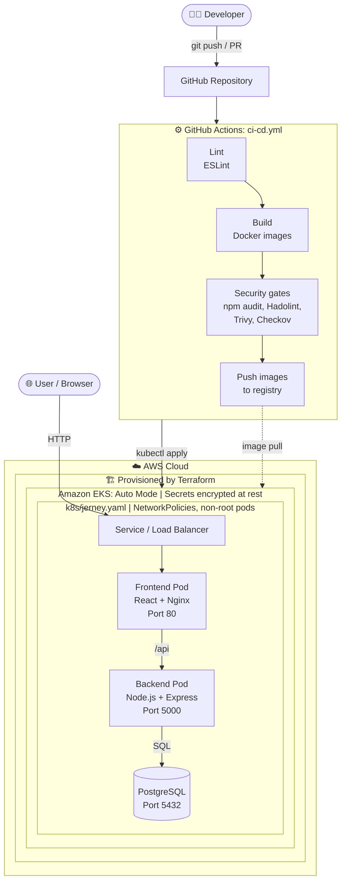
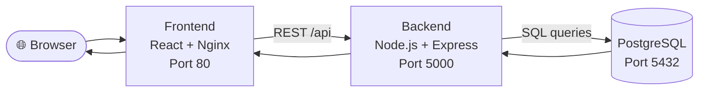

# 🛤️ Journey: Blog Platform with a DevSecOps Pipeline
 
A Gen-Z vibe blog platform built as a **3-tier application** (React, Node.js, PostgreSQL) and shipped with a complete **DevSecOps workflow**: Docker, Kubernetes on AWS EKS, Terraform, GitHub Actions CI/CD, and automated security scanning.
 
---
 
## ✨ Features
 
**Application**
- 📝 Create blog posts with emoji vibes
- ✏️ Edit your existing posts
- 🗑️ Delete posts you're not feeling anymore
- 💬 Comment on posts
- 🎨 Dark UI with glassmorphism and gradients
**DevSecOps**
- 🐳 Multi-container setup with Docker and Docker Compose
- ☸️ Kubernetes manifests deployed to Amazon EKS (Auto Mode)
- 🏗️ Infrastructure as Code with Terraform
- 🔁 Automated 10-stage CI/CD pipeline with GitHub Actions
- 🔐 Shift-left security: ESLint, npm audit (SCA), Hadolint, Trivy, and Checkov
- 🛡️ Hardened runtime: Kubernetes NetworkPolicies, non-root containers, read-only filesystems, dropped capabilities
- 🔑 EKS secrets encryption at rest
---
 
## 🏗️ Architecture
 
### DevSecOps Architecture
 

 
### 3-Tier Application Flow
 

 
---
 
## 🧰 Tech Stack
 
| Layer | Technology |
|-------|-----------|
| Frontend | React 18, Vite, Nginx |
| Backend | Node.js 20, Express |
| Database | PostgreSQL 16 |
| Containers | Docker, Docker Compose |
| Orchestration | Kubernetes (Amazon EKS Auto Mode) |
| Infrastructure as Code | Terraform |
| CI/CD | GitHub Actions |
| Security | ESLint, npm audit, Hadolint, Trivy, Checkov, Kubernetes NetworkPolicies |
 
---
 
## 📁 Project Structure
 
```
Jerney/
├── .github/
│   └── workflows/
│       └── ci-cd.yml            # GitHub Actions CI/CD pipeline
├── backend/                     # Node.js Express API
│   ├── src/                     # Routes, DB connection
│   ├── Dockerfile
│   ├── .dockerignore
│   ├── .eslintrc.json
│   └── package.json
├── frontend/                    # React (Vite) frontend
│   ├── src/                     # React components & pages
│   ├── Dockerfile
│   ├── .dockerignore
│   ├── .eslintrc.json
│   ├── nginx.conf               # Nginx config for serving the app
│   ├── vite.config.js
│   └── package.json
├── k8s/
│   └── jerney.yaml              # Kubernetes manifests
├── terraform/
│   ├── main.tf                  # Core infrastructure (EKS)
│   ├── provider.tf              # Provider configuration
│   ├── variables.tf             # Input variables
│   ├── terraform.tfvars         # Variable values
│   └── outputs.tf               # Output values
├── deploy/                      # Bare-metal EC2 deployment scripts
│   ├── setup.sh
│   └── jerney-nginx.conf
├── docker-compose.yml           # Local multi-container setup
├── .checkov.yml                 # Checkov IaC scan configuration
└── README.md
```
 
---
 
## 🚀 Getting Started
 
### Option 1: Run with Docker Compose (fastest)
 
**Prerequisites:** Docker and Docker Compose
 
```bash
git clone <your-repo-url>
cd Jerney
git checkout devops
 
docker compose up --build
```
 
Then open `http://localhost` (or the port mapped in `docker-compose.yml`).
 
To stop everything:
 
```bash
docker compose down
```
 
### Option 2: Local Development (without Docker)
 
**Prerequisites:** Node.js 20+ and PostgreSQL 16+
 
**Backend**
 
```bash
cd backend
npm install
 
# Create a .env file (or export these variables)
export DB_HOST=localhost
export DB_PORT=5432
export DB_USER=<your_db_user>
export DB_PASSWORD=<your_db_password>
export DB_NAME=<your_db_name>
export PORT=5000
 
npm start
```
 
**Frontend**
 
```bash
cd frontend
npm install
npm run dev
```
 
The Vite dev server starts on `http://localhost:3000` and proxies `/api` requests to the backend at `http://localhost:5000`.
 
> [!WARNING]
> Never commit real credentials. Use environment variables, a `.env` file listed in `.gitignore`, or Kubernetes Secrets.
 
---
 
## ☁️ Deploy to AWS EKS
 
### Prerequisites
 
- AWS account with credentials configured (`aws configure`)
- [Terraform](https://developer.hashicorp.com/terraform/install)
- [kubectl](https://kubernetes.io/docs/tasks/tools/)
- [AWS CLI](https://aws.amazon.com/cli/)
### Step 1: Provision the infrastructure
 
```bash
cd terraform
terraform init
terraform plan
terraform apply
```
 
### Step 2: Connect kubectl to the cluster
 
```bash
aws eks update-kubeconfig --region <your-region> --name <your-cluster-name>
kubectl get nodes
```
 
### Step 3: Deploy the application
 
```bash
kubectl apply -f k8s/jerney.yaml
kubectl get pods
kubectl get svc
```
 
Use the external address of the service to open the app in your browser.
 
### Tear down
 
```bash
kubectl delete -f k8s/jerney.yaml
cd terraform
terraform destroy
```
 
---
 
## 🔁 CI/CD Pipeline
 
The 10-stage pipeline is defined in [`.github/workflows/ci-cd.yml`](.github/workflows/ci-cd.yml) and runs on pushes and pull requests.
 
| Check / Stage | Tool | What it does |
|---------------|------|--------------|
| **Code linting** | ESLint | Enforces code quality on the frontend and backend |
| **Dependency scanning (SCA)** | npm audit | Flags known vulnerabilities in npm dependencies |
| **Dockerfile linting** | Hadolint | Checks Dockerfiles for best-practice and security issues |
| **Image build** | Docker | Builds the frontend and backend images |
| **Image vulnerability scan** | Trivy | Scans container images for known CVEs |
| **IaC security scan** | Checkov | Scans Terraform and Kubernetes manifests for misconfigurations |
| **Publish and deploy** | Container registry, kubectl | Pushes images and applies the manifests to the EKS cluster |
 
> Reorder or split these rows to match the exact 10 jobs in your workflow file.
 
---
 
## 🔐 Security
 
Security is applied at every layer: code, dependencies, containers, infrastructure, and runtime.
 
**Pipeline (shift-left)**
- ✅ **ESLint**: code linting
- ✅ **npm audit**: Software Composition Analysis (SCA) of dependencies
- ✅ **Trivy**: container image vulnerability scanning
- ✅ **Hadolint**: Dockerfile linting
- ✅ **Checkov**: IaC security scanning for Terraform and Kubernetes manifests (rules configured in `.checkov.yml`)
**Kubernetes runtime hardening**
- ✅ **NetworkPolicies**: zero-trust pod-to-pod communication, so only the traffic that is explicitly allowed gets through
- ✅ **Non-root containers**, **read-only filesystems**, and **dropped Linux capabilities**
**Cluster and secrets**
- ✅ **EKS secrets encryption at rest**
- ✅ `.dockerignore` files keep secrets and unnecessary files out of the build context
- ✅ Credentials are supplied through environment variables or Kubernetes Secrets, never hard-coded
---
 
## 📡 API Endpoints
 
| Method | Endpoint | Description |
|--------|----------|-------------|
| GET | `/api/health` | Health check |
| GET | `/api/posts` | Get all posts |
| GET | `/api/posts/:id` | Get single post with comments |
| POST | `/api/posts` | Create a new post |
| PUT | `/api/posts/:id` | Update a post |
| DELETE | `/api/posts/:id` | Delete a post |
| GET | `/api/comments/post/:postId` | Get comments for a post |
| POST | `/api/comments` | Create a comment |
| DELETE | `/api/comments/:id` | Delete a comment |
 
---
 
## 🖥️ Alternative: Bare-Metal Deployment on EC2
 
Prefer a simple single-server setup? The [`main`](../../tree/main) branch includes a one-click script (`deploy/setup.sh`) that installs Node.js, PostgreSQL, Nginx, and PM2 on an Ubuntu 22.04+ EC2 instance and starts the app.
 
```bash
git checkout main
chmod +x deploy/setup.sh
./deploy/setup.sh
```
 
